<div align="center">

# Real-Time Commerce Platform

**An event-driven commerce backend that processes every event at least once and applies it exactly once.**

Customer journeys, from browsing through payment and refund, stream through Kafka
into a Go processor. Each event is validated, guarded by an idempotency lease,
written in a single PostgreSQL transaction together with its fraud decision and
outbox row, and only then is its offset committed. Anything that cannot be
applied lands in a dead-letter queue, where you can triage it and replay it.

[](https://github.com/negativexq/real-time-commerce-platform/actions/workflows/ci.yml)


[](LICENSE)

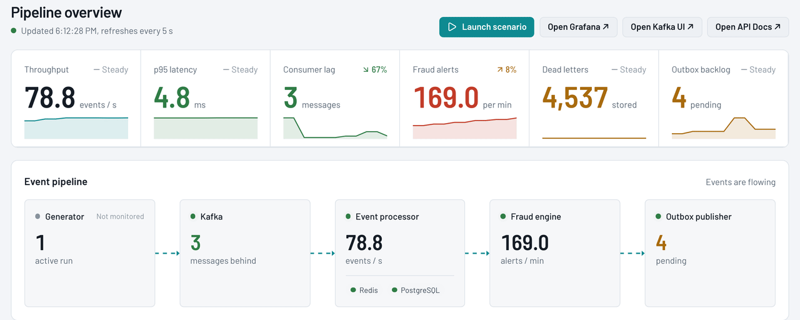

<sub>The Overview during a mixed-traffic run, refreshing every 5 seconds. Every number comes from Prometheus or PostgreSQL, so nothing on the page is simulated.</sub>

</div>

---

## Contents

- [What it does](#what-it-does)
- [A tour of the console](#a-tour-of-the-console)
- [How it works](#how-it-works)
- [Quickstart](#quickstart)
- [Five-minute demo](#five-minute-demo)
- [Performance](#performance)
- [Feature reference](#feature-reference)
- [Development](#development)
- [Known limitations](#known-limitations)
- [Production evolution](#production-evolution)
- [Troubleshooting](#troubleshooting)

## What it does

| | |
|---|---|
| 🛒 **Generates realistic journeys** | Seeded personas (normal shoppers, bots, account takeovers, discount hunters and others) produce stateful, versioned events in a valid order: sessions, carts, orders, payments, refunds. Eight fixed scenarios bound the count and rate. |
| 🔁 **Applies each event once** | Delivery is at least once. A Redis lease stops two workers from processing the same event at the same time, and PostgreSQL uniqueness rejects a second durable effect. A duplicate is recognised and skipped instead of double-charging an order. |
| 🧾 **Commits atomically** | Business state, the fraud decision and the outbox row for one source event commit in one transaction. The Kafka offset moves only after that, in bounded batches that never skip an unresolved gap. |
| 🚨 **Scores fraud as it streams** | Deterministic rules (payment velocity, failed-payment bursts, new devices, country mismatch, rapid checkout, takeover and refund-abuse patterns) produce APPROVE, REVIEW or BLOCK with an explainable score. Alerts leave through a transactional outbox. |
| 📮 **Keeps failures recoverable** | Transient failures retry with capped, jittered backoff. Invalid or exhausted records go to a DLQ topic, a sink copies them into PostgreSQL, and the console lets you triage, discard or replay them. Replay is offered only for failures where a second try can succeed. |
| 🔭 **Shows its work** | Prometheus metrics with bounded labels on every service, recording and alert rules, seven provisioned Grafana dashboards, and a console with live run progress, service health and a notification bell. |
| ⚡ **Measured, not guessed** | The Go processor replaced a Python one after an A/B on the same benchmark. Go held 1,400 evt/s, where Python fell behind, at 19 times lower p95 latency, using 30–35% less CPU. |

It all starts with one `make demo-up`: Kafka, PostgreSQL, Redis, the processor,
the DLQ sink, the outbox publisher, Prometheus, Grafana, exporters, Kafka UI, and
the console.

## A tour of the console

### Overview

Six KPIs with short trends, the event pipeline stage by stage, service levels
against their alert limits, and the fraud outcome of the latest run. The page
polls every 5 seconds, pauses while the tab is hidden, and reads through a
server-side cache, so ten open tabs cost Prometheus no more than one.

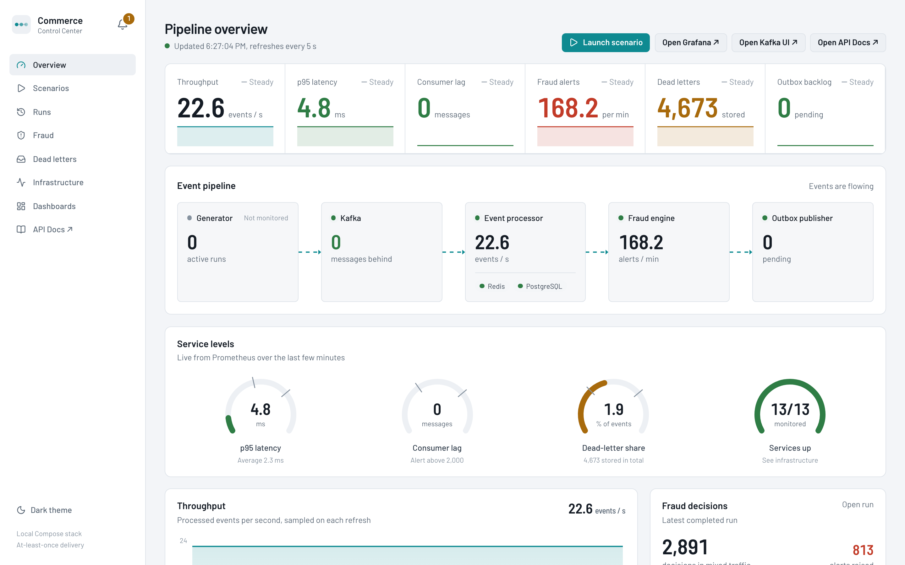

### Scenarios

Eight fixed scenarios, each with a stated purpose and expected outcome. Count,
rate, seed and anomaly options are bounded by server-side limits, and mixed
traffic takes a persona distribution.

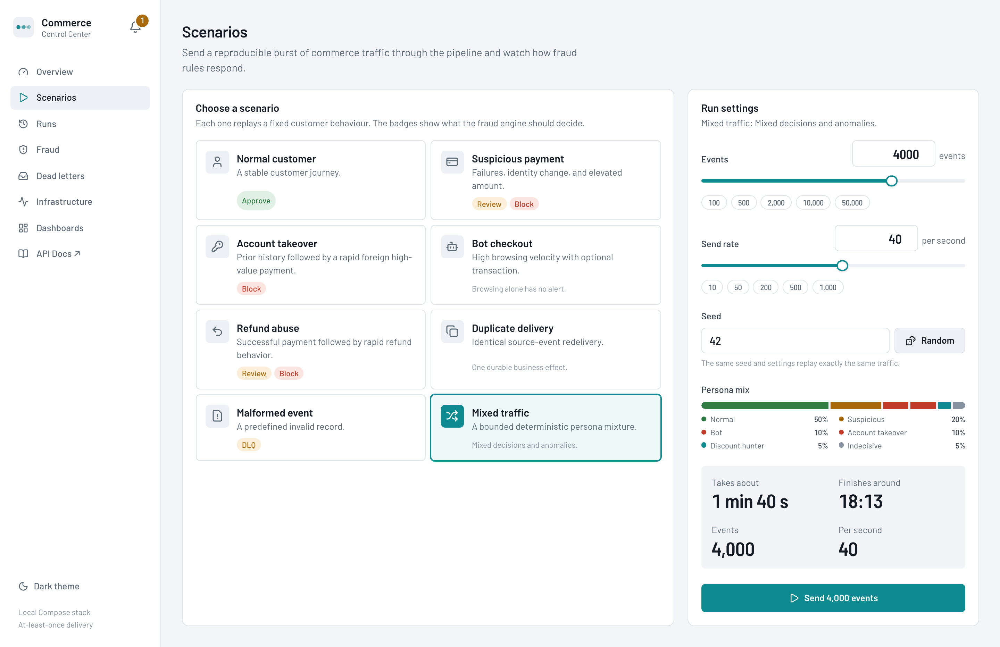

### A run, live

Progress streams over Server-Sent Events: generated and processed counts, dead
letters, and fraud decisions as they are made. A run can be stopped gracefully or
retried safely.

<p align="center">
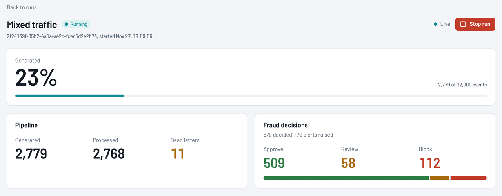
</p>

Every run is kept with its exact outcome, read from PostgreSQL rather than
Prometheus, so a run's numbers never drift with a scrape interval.

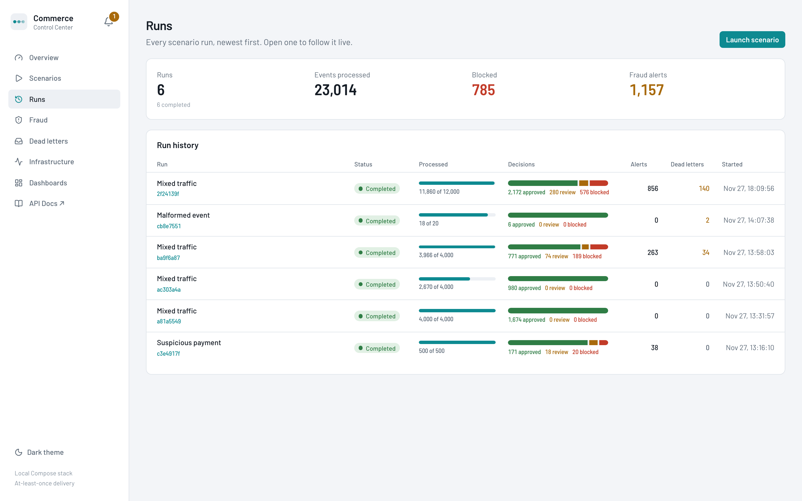

### Fraud

Decisions across every run, alerts by severity, and each alert's score, decision,
the rules it matched and whether the outbox has published it.

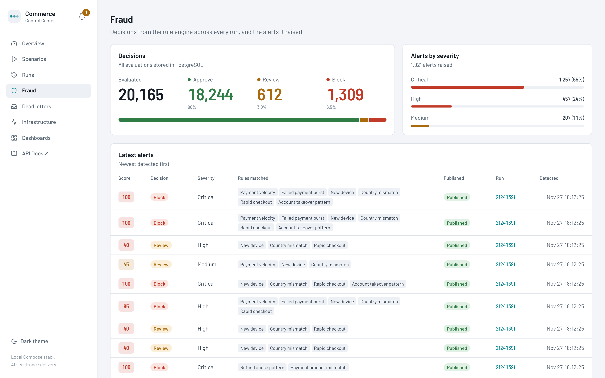

### Dead letters: triage and replay

Every record the processor could not apply, grouped by status and failure
category. Categories marked **Replayable** can succeed on a second try. The others
fail the same way every time and can be triaged or discarded in bulk.

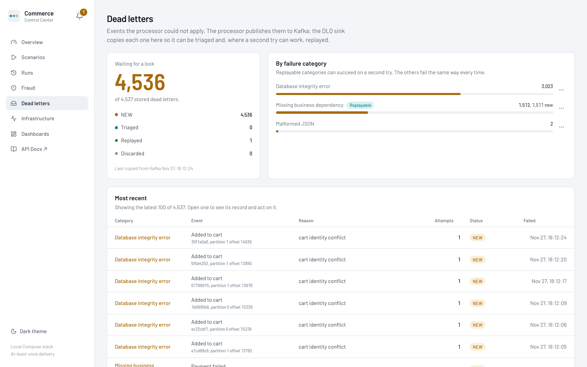

Opening a record shows the original payload and headers, why it failed and where
it came from. If a replay dead-letters again, the drawer says so and links the new
record.

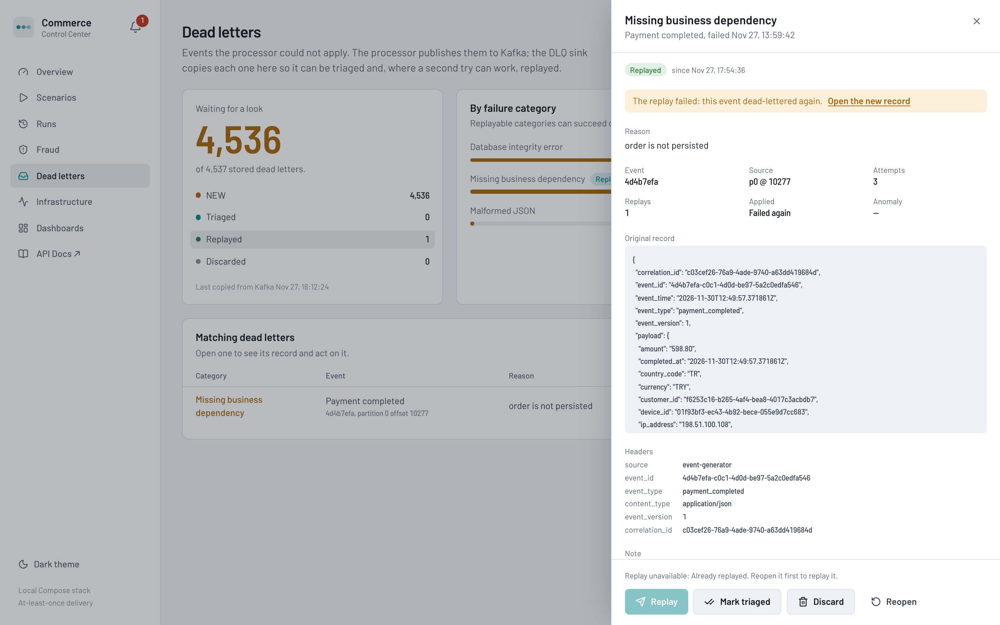

### Infrastructure and alerts

Each dependency's health comes from a real check. Firing Prometheus alerts reach
the bell. Warnings can be cleared, but critical alerts stay until they resolve.
Here the DLQ sink was stopped on purpose, and `DLQSinkDown` fired a minute later.

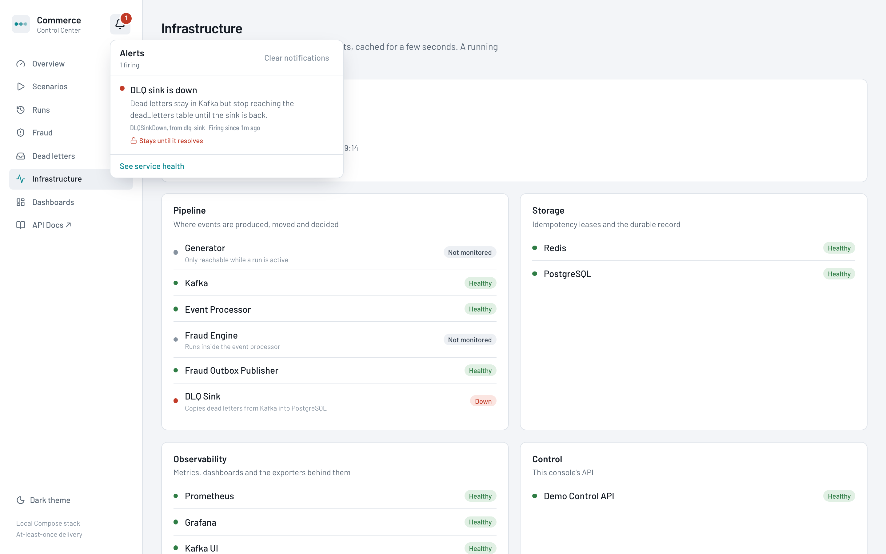

### Grafana

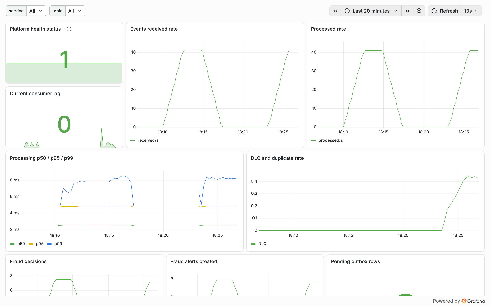

<sub><b>Commerce Platform Overview</b>, one of seven provisioned dashboards (Kafka Streaming, Processor, Persistence, Fraud, Outbox, Infrastructure).</sub>

## How it works

### Architecture

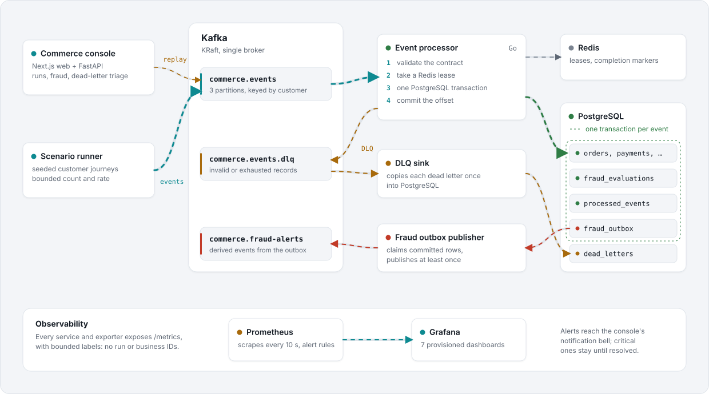

Docker Compose runs everything on one local network. Kafka is a single KRaft
broker. PostgreSQL is the system of record, and Redis holds only coordination
state that can be rebuilt. The processor never calls another service directly:
everything it produces is either a row in its transaction or a Kafka record.

### One event through the processor

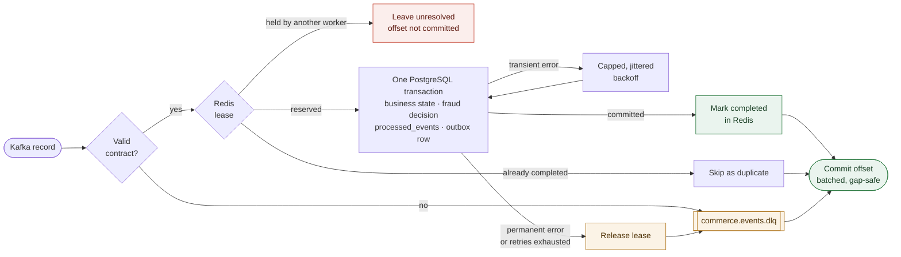

A DLQ record is published and confirmed **before** the source offset is
committed, so a crash in between redelivers the event instead of losing it.
Offsets are committed per partition in contiguous batches (50 records or 100 ms),
flushed on idle, rebalance and shutdown, and never past an unresolved record.

### The dead-letter loop

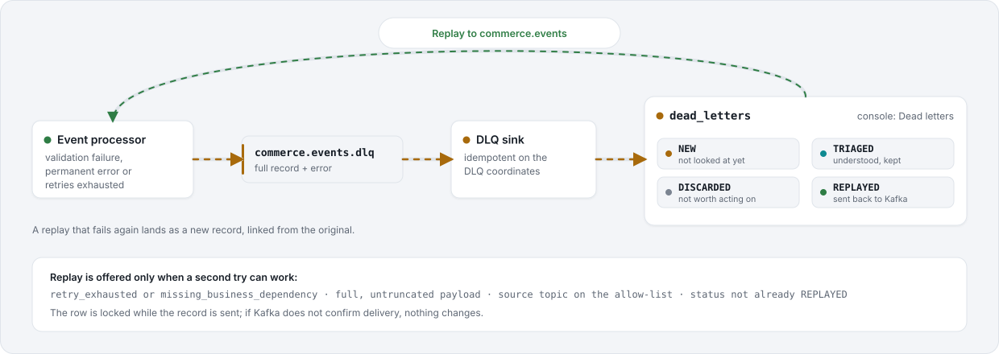

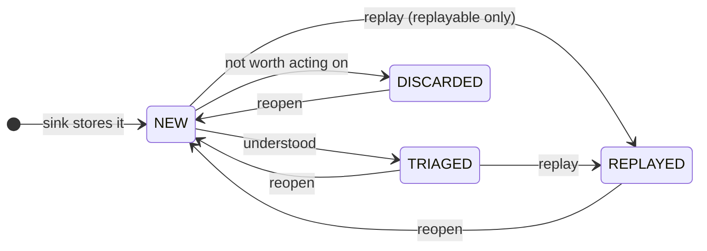

The processor only publishes to Kafka. It never writes dead letters to the
database itself, so a database outage cannot block the failure path. The sink is
idempotent on the DLQ topic, partition and offset. A replay re-publishes the
original key, value and headers to the source topic with a
`replayed_from_dlq_record_id` header. The record stays locked while it sends, and
the status changes only after Kafka confirms delivery.

### Delivery guarantees

| Guarantee | How |
|---|---|
| No lost events | Offsets are committed only after terminal handling: applied, recognised as a duplicate, or confirmed in the DLQ. |
| No double effects | A Redis token-checked lease coordinates active work, and PostgreSQL uniqueness on `processed_events` and business keys protects durable effects even if Redis forgets. |
| Alerts follow decisions | Fraud alerts and outbox rows commit with the decision. A separate publisher claims committed rows and publishes at least once. |
| Ordering | Per partition, and events are keyed by customer. There is no global order. |

The full lifecycle, a crash-recovery timeline, the sequence diagram and the design
decisions are in [`docs/architecture/`](docs/architecture/README.md). Those
documents describe recovery paths that CI does not yet execute as process crashes
(see [Known limitations](#known-limitations)).

## Quickstart

Prerequisites: Git, Docker with Compose, and GNU Make.

```bash
git clone https://github.com/negativexq/real-time-commerce-platform.git
cd real-time-commerce-platform
make demo-up        # builds and starts the whole stack
make demo-status    # wait until services are Up / healthy
```

| | |
|---|---|
| Console | http://localhost:3003 |
| API docs | http://localhost:8082/docs |
| Kafka UI | http://localhost:8080 |
| Prometheus | http://localhost:9090 |
| Grafana | http://localhost:3002 |

No configuration is needed: Compose ships safe local defaults, and every port
binds to `127.0.0.1`. To change ports, copy `.env.example` to `.env`, and never put
real credentials in it. Data lives in named volumes and survives rebuilds.
`make clean` stops the stack and keeps the data. `make clean-volumes` deletes all
local data.

<details>
<summary>All services</summary>

| Service | Port | What it is |
|---|---|---|
| `demo-control-web` | 3003 | The console (Next.js) |
| `demo-control-api` | 8082 | Scenario control, run history, fraud and DLQ APIs (FastAPI) |
| `event-processor` | `:9101/metrics` | Go consumer: validation, leases, transaction, offsets |
| `dlq-sink` | metrics only | Copies `commerce.events.dlq` into `dead_letters` |
| `fraud-outbox-publisher` | metrics only | Publishes committed outbox rows to `commerce.fraud-alerts` |
| `kafka` | 29092 | Single KRaft broker; `kafka-init` creates the topics |
| `postgres` | 5432 | System of record; `postgres-migrate` applies checksummed migrations |
| `redis` | 6379 | Idempotency leases and completion markers |
| `prometheus` | 9090 | Scrapes every 10 s, recording and alert rules |
| `grafana` | 3002 | Seven provisioned dashboards, anonymous viewer access |
| `kafka-ui` | 8080 | Topic and consumer-group browser |
| `kafka-exporter`, `postgres-exporter`, `redis-exporter` | internal | Infrastructure metrics |

</details>

## Five-minute demo

**1. A clean run.** Open http://localhost:3003/scenarios, choose **Normal
customer** and start it, or run `make demo-run-normal`. The run page fills live
and finishes **COMPLETED**: every event processed, every decision APPROVE, no
alerts.

**2. Fraud under mixed traffic.** Start **Mixed traffic**, or run
`make demo-run-mixed`. Bots, takeovers and suspicious payers now produce REVIEW
and BLOCK decisions. Open **Fraud** to see which rules each alert matched and
watch the outbox publish them. The Overview's fraud-alert and dead-letter tiles
move with it.

**3. Break something and recover it.** Run **Malformed event**
(`make demo-run-malformed`). Invalid records go straight to the DLQ, which the
**Dead letters** page shows within seconds. Open one to read the payload and the
reason, then mark it triaged or discard the category in bulk. Mixed traffic also
leaves a few records under **Missing business dependency**, which carry a
**Replayable** badge: replay one, and the processor receives it again from
`commerce.events`.

**4. Watch an alert fire.** Stop the sink with
`docker compose stop dlq-sink`. About a minute later the bell shows `DLQSinkDown`
as critical and **Infrastructure** marks the sink Down. Start it again with
`docker compose start dlq-sink`. It catches up from its committed offset, and
the alert resolves on its own.

## Performance

The processor was ported from Python to Go and measured with the unchanged
direct-injector sweep against both runtimes. Both started from the same reset
state: 3 workers, 3 partitions, 2 repeats per rate, 10 s warmup and 45 s of
measured load. A repeat counts as sustainable when lag grows by at most 5 events
per second.

| Rate | Runtime | Service rate | Lag slope | E2E p95 | Processor CPU (peak, 3 replicas) | Sustainable |
|---:|---|---:|---:|---:|---:|:---:|
| 1,200 evt/s | Python | 1,197 | +2.1/s | 235 ms | 158% | 2/2 |
| 1,200 evt/s | **Go** | 1,197 | +1.4/s | **51 ms** | **104%** | 2/2 |
| 1,400 evt/s | Python | 1,371 | +26.2/s | 1,686 ms | 182% | ❌ 0/2 |
| 1,400 evt/s | **Go** | 1,395 | +3.0/s | **89 ms** | **124%** | ✅ 2/2 |
| 1,700 evt/s | Python | 1,477 | +220.1/s | 12,939 ms | 188% | 0/2 |
| 1,700 evt/s | **Go** | **1,676** | +18.2/s | 1,065 ms | 175% | 0/2 |

Go held 1,400 evt/s where Python's ceiling sits between 1,200 and 1,400. Saturated
at 1,700 evt/s, it processed about 13% more. Every repeat in both runtimes
processed exactly the events it injected, with zero errors. Medians of two
repeats, measured locally in Docker. These are not production SLAs. Details,
including a cold-start effect from PostgreSQL's plan cache, are in
[`artifacts/benchmark/runtime-ab-20261127`](artifacts/benchmark/runtime-ab-20261127/README.md).

<details>
<summary>Capacity depends on the workload</summary>

Throughput depends on how much of the traffic takes the fraud path, which adds
context reads, evaluation and fraud persistence. The fraud-eligible events are
`checkout_started`, `order_created`, `payment_completed`, `payment_failed` and
`refund_requested`. Fraud-eligible share is not the fraud detection rate: an
eligible event can still be approved.

| Fraud-eligible share | Highest near-line-rate observation | Transition / degraded candidate |
| ---: | ---: | ---: |
| ~42.8% (historical baseline) | 1,075 evt/s | 1,100 evt/s |
| ~20% | 1,200 evt/s | 1,300 evt/s |
| ~10% | 1,400 evt/s | 1,500–1,600 evt/s |
| ~5% | near line rate through 1,500–1,600 evt/s | boundary not fully resolved |
| 0% | 1,600 evt/s | 1,700 evt/s |

These measured the retired Python processor with three workers on a 1/1/1
partition assignment. The groups ran in separate benchmark-state regimes, so read
the table as a sensitivity study, not a single capacity curve. Accepted runs
required: unique injected IDs matching durable `processed_events` rows, no
unexpected dependency, integrity or DLQ records, lag and outbox draining to zero,
and fraud-evaluation counts matching the eligible-event count. The 0% profile
contained exactly zero eligible events. It did not disable fraud processing.

How the profiles are built and runs classified:
[Fraud-eligible workload profiles](docs/deep-dives/fraud-workload-profiles.md) and
[Benchmark methodology](docs/deep-dives/benchmark-methodology.md).

</details>

<details>
<summary>How the isolated pipeline got from ~750 to ~1,050 evt/s</summary>

Two benchmark scopes are kept apart on purpose. The **demo full path** runs from
the API through the scenario runner, Kafka and the processor. The **isolated
pipeline** uses a benchmark-only direct injector into Kafka, then the processor
and persistence. The isolated result is not a continuation of the demo-path
series.

| Stage | Observation | Change or experiment | Result |
| --- | --- | --- | --- |
| Initial demo full path | A 100 evt/s request produced much less traffic although handler latency was low. | Profile the scenario runner. | **49.843 evt/s median**. |
| Generator hot path | Synchronous progress refresh and `work(); sleep(1/rate)` stretched every event period. | Coalesce refresh work off the event loop and use monotonic fixed-rate deadlines. | **97.934 evt/s median** on the same benchmark. |
| Transaction decomposition | Payment-history reads dominated PostgreSQL work. Commit and pool acquire did not. | Measure SQL classes and transaction stages first. | Recent/prior lookups identified as the expensive class. |
| Combined payment lookup | Fewer round trips might reduce transaction cost. | Combine the two reads into one query. | Throughput and latency regressed: **reverted**. |
| Query-plan optimization | Payment-history predicates used a `Seq Scan`. | Add `payments(customer_id, attempted_at DESC)`. | Recent **10.897 → 0.253 ms**, prior **7.143 → 0.100 ms**, transaction **~7 → 1.7–1.8 ms**. |
| Isolated single processor | The demo path could no longer feed the processor fast enough. | Introduce the direct Kafka injector. | About **500 evt/s** with one serial worker. |
| Two workers | A second consumer should add capacity. | Two consumers, three partitions. | At 600 requested: **502.0 → 584.5 evt/s**. The 2/1 assignment limited scaling. |
| Three-worker alignment | Partition assignment bounded useful concurrency. | Three workers on a 1/1/1 assignment. | **742.185 evt/s** sustained at 750 requested. |
| Boundary refinement | Processed rate alone can hide a growing backlog. | Classify by lag slope and drain. | 775 failed every repeat: transition **750–775 evt/s**. |
| Batched offset commits | A synchronous commit per event bounded throughput on the Kafka round trip. | Contiguous per-partition batches (50 records or 100 ms), never past a gap. | **~28.6x fewer commit calls**; boundary **750 → 900 evt/s**. |
| Success-log volume | The per-event success log ran at INFO on the hot path. | Move it to DEBUG. | **~254 MB → ~7 KB stdout**, no material throughput change; kept for log volume. |
| Orders composite index | Fraud context sorted a `customer_id`-only bitmap scan. | Add `orders(customer_id, ordered_at DESC)`. | **0.195 → 0.073 ms**, 39 → 5 buffers. Kept. |
| Product-views composite index | Same pattern on `product_views`. | Add `product_views(customer_id, viewed_at DESC)`. | **0.613 → 0.172 ms**, 60 → 5 buffers. Kept, without claiming a standalone throughput gain. |
| Post-index capacity sweep | The boundary needed re-establishing from clean data. | Full reset, then a 950–1,100 evt/s sweep. | **1,000 and 1,050 clean in 3/3; 1,075 degraded in 2/3.** Transition ~1,050–1,075 evt/s. |

That is about 40% more sustainable capacity than the ~750 evt/s baseline,
reached in two separately retained steps. The rejected combined-query experiment
stays in the record because the steady-state benchmark contradicted its
hypothesis.

The evidence runs from the [Performance Report](docs/performance-report.md) to the
[Methodology](docs/performance/methodology.md),
[Optimization History](docs/performance/optimization-history.md),
[Scaling Analysis](docs/performance/scaling-analysis.md) and the
[Benchmark Artifact Index](artifacts/benchmark/README.md). The Python-era artifact
directories were removed when the processor moved to Go and can be recovered from
git history.

</details>

## Feature reference

<details>
<summary>Scenarios and personas</summary>

| Scenario | What it shows |
|---|---|
| Normal customer | A clean journey: every event applied, every decision APPROVE |
| Suspicious payment | Payment failures, an identity change and an elevated amount: REVIEW or BLOCK |
| Account takeover | Prior history, then a rapid, foreign, high-value payment: BLOCK and an alert |
| Bot checkout | High browsing velocity with an optional transaction; browsing alone raises no alert |
| Refund abuse | A successful payment followed by rapid refunds: REVIEW or BLOCK |
| Duplicate delivery | Identical source events redelivered: one durable business effect |
| Malformed event | A predefined invalid record, routed to the DLQ |
| Mixed traffic | A persona mix: normal 50, suspicious 20, bot 10, account takeover 10, discount hunter 5, indecisive 5 |

Journeys are deterministic for a seed. See [Scenario & journey generation](docs/deep-dives/scenario-generation.md),
[Personas and anomalies](docs/personas-and-anomalies.md) and the
[Event generator](docs/event-generator.md).

</details>

<details>
<summary>Event contracts and processing</summary>

- **Versioned contracts.** One shared envelope and payload registry is the
  validation boundary for producers and the consumer ([Event contracts](docs/event-contracts.md)).
- **Classified failures.** Transient database and dependency errors retry with
  capped, jittered backoff. Permanent errors and validation failures go straight
  to the DLQ. Missing-dependency failures (an order for a customer the processor
  hasn't stored yet) are retried, then dead-lettered as replayable.
- **Gap-safe offsets.** Per-partition contiguous batching, with synchronous
  flushes on idle, rebalance and shutdown.
- **Leases released on failure,** so a replayed event is processed rather than
  skipped as a duplicate.

See [Event processor](docs/event-processor.md) and
[`services/event_processor_go/`](services/event_processor_go/README.md).

</details>

<details>
<summary>Fraud engine and outbox</summary>

Rules score each fraud-eligible event from its customer, order and payment context.
The score maps to APPROVE, REVIEW or BLOCK, with a severity, and every alert
records the rules it matched. Alerts and outbox rows commit in the processor's
transaction. The outbox publisher claims committed rows, publishes them to
`commerce.fraud-alerts` and marks them published, retrying on failure. See
[Fraud engine and outbox](docs/fraud-engine.md) and
[Fraud decision strategy](docs/deep-dives/fraud-decision-strategy.md).

</details>

<details>
<summary>Dead letters</summary>

| | |
|---|---|
| Statuses | `NEW`, `TRIAGED`, `DISCARDED`, `REPLAYED`, with an optional note (up to 500 characters) and reopen |
| Replayable categories | `retry_exhausted`, `missing_business_dependency` |
| Replay needs | a full, untruncated payload, a source topic on `DEMO_DLQ_REPLAY_TOPICS` (default `commerce.events`), and a status that is not already `REPLAYED` |
| Replay delivery | idempotent producer, `acks=all`. The row is locked `FOR UPDATE`, and the transaction rolls back if delivery isn't confirmed |
| Bulk actions | mark triaged or discard every `NEW` record in one category; handled records are left alone |
| Failed again | a newer dead letter for the same event after a replay is linked from the original |

</details>

<details>
<summary>Observability</summary>

Prometheus scrapes the processor, generator, DLQ sink, outbox publisher, API and
the Kafka, PostgreSQL and Redis exporters every 10 seconds. Labels are bounded:
no run IDs or business identifiers.

- Rates, processing latency histograms, consumer lag, retries, duplicates and DLQ
  publications by category.
- PostgreSQL and Redis operation outcomes, fraud decision and alert rates, and
  outbox pending and publication state.
- Alert rules cover the processor being down, consumer lag, the DLQ rate,
  PostgreSQL or Redis being unavailable, outbox backlog and publication failures,
  processing latency, and the DLQ sink (`DLQSinkDown` is critical,
  `DLQSinkStoreErrors` and `DLQSinkBehind` are warnings).

The console reads metrics through the API, which caches them (5 s for metrics, 10 s
for alerts) and coalesces concurrent requests. It exposes neither arbitrary PromQL
nor arbitrary SQL. Run-specific counts come from PostgreSQL. See
[Prometheus and Grafana](docs/observability.md).

```bash
make prometheus-targets
make prometheus-query-smoke
make grafana-dashboards-check
```

</details>

<details>
<summary>API</summary>

Interactive OpenAPI docs are at http://localhost:8082/docs. Prefix each route with
`/api/v1`. Mutating routes accept an optional token guard.

| Routes | Purpose |
| --- | --- |
| `GET /health`, `GET /ready` | Liveness, and readiness backed by PostgreSQL |
| `GET /scenarios`, `GET /scenarios/{scenario_type}` | The fixed scenario catalog and its bounded options |
| `POST /runs`, `GET /runs`, `GET /runs/{run_id}` | Start a scenario; paginated history; one run |
| `POST /runs/{run_id}/stop`, `POST /runs/{run_id}/retry` | Stop gracefully, or create a safe retry run |
| `GET /runs/{run_id}/summary`, `/timeline`, `/stream` | Exact outcomes, a bounded timeline, live SSE progress |
| `GET /overview/fraud-summary` | A consistent fraud summary for the active or latest run |
| `GET /platform/health`, `/metrics/summary`, `/topics`, `/services` | Cached health and restricted platform metrics |
| `GET /platform/alerts` | Active Prometheus alerts, firing and critical first |
| `GET /fraud/alerts`, `/fraud/evaluations`, `/fraud/alerts/{alert_id}` | Bounded, sanitized fraud results |
| `GET /dlq`, `GET /dlq/{dlq_record_id}` | Dead letters filtered by status and category; one record with its payload |
| `POST /dlq/{dlq_record_id}/status`, `/dlq/{dlq_record_id}/replay`, `/dlq/bulk-status` | Triage, discard or reopen; replay; bulk status by category |
| `GET /dashboards` | Provisioned Grafana dashboards and URLs |
| `DELETE /runs/{run_id}/test-data` | Remove only a terminal run's own demo data |

Prometheus scrapes the API's separate `/metrics` endpoint.

</details>

<details>
<summary>Design patterns</summary>

| Pattern | How it is used |
| --- | --- |
| Event-driven architecture | Journeys travel through explicit Kafka topics, not direct service calls. |
| Idempotent consumer | Redis leases coordinate active work, and PostgreSQL uniqueness prevents repeated durable effects. |
| Unit of Work | Each source event and its business and fraud effects commit in one transaction. |
| Transactional outbox | Fraud alerts and outbox rows commit together, and a separate publisher delivers them. |
| Dead letter queue | Invalid or exhausted records go to `commerce.events.dlq`, and an idempotent sink makes them queryable. |
| Bounded retry | Only classified transient failures retry, with capped backoff. |
| Consumer groups | The processor scales by partition assignment with manual, post-terminal commits. |
| Read models | Business tables and run manifests answer queries without replaying the stream. |

The project doesn't use event sourcing or claim CQRS: PostgreSQL is the durable
business record.

</details>

<details>
<summary>Technology stack and repository layout</summary>

| Area | Technologies |
| --- | --- |
| Languages | Go 1.26 (processor), Python 3.12+, TypeScript 5 |
| Processor | `confluent-kafka-go`, pgx v5, go-redis v9, Prometheus client |
| Services | FastAPI, Pydantic v2, Uvicorn, psycopg 3 with a connection pool, httpx, structlog, `confluent-kafka` |
| Console | Next.js 16 App Router, React 19, Tailwind CSS v4, Base UI, Recharts |
| Messaging and storage | Apache Kafka 3.9 (KRaft), PostgreSQL 17, Redis 7 |
| Observability | Prometheus, Grafana, Kafka/PostgreSQL/Redis exporters |
| Tooling | Docker Compose, GNU Make, Ruff, mypy, pytest, `go vet`, Vitest |

| Path | Purpose |
| --- | --- |
| `apps/demo_control_web/` | The console |
| `services/event_processor_go/` | The Go processor and DLQ sink |
| `services/demo_control_api/`, `event_generator/`, `fraud_outbox_publisher/`, `db_migrations/` | Python services |
| `shared/` | Versioned event schemas, domain helpers, Kafka metadata, metrics |
| `database/` | First-run SQL and ordered, checksum-verified migrations |
| `infra/observability/` | Prometheus configuration and rules, Grafana provisioning |
| `infrastructure/kafka/` | Topic initialization |
| `scripts/` | Smoke tests, verification, benchmarks, scoped cleanup |
| `tests/` | Python unit and integration tests; Go tests sit next to the Go code |
| `docs/` | Contracts, services, architecture, performance, deep dives |

</details>

## Development

```bash
python3.12 -m venv .venv && source .venv/bin/activate
python -m pip install -e ".[dev]"
make check          # Ruff lint + format check, strict mypy, pytest
make go-check       # gofmt, go vet, go test for the processor
make web-check      # console: npm ci, typecheck, Vitest, production build
```

**CI** runs four jobs on every push and pull request:

| Job | What it runs |
|---|---|
| `quality` | `make check` with no live services, so integration tests skip |
| `go-processor` | gofmt, `go vet` and the Go tests, including Redis lease and persistence tests against real services |
| `demo-web` | `npm ci`, typecheck, Vitest and `next build` on Node 22 |
| `integration` | Starts Kafka, PostgreSQL and Redis, runs `pytest -m integration` against the Go processor container, and fails if a marked test skips or none runs |

Against the real stack, integration tests verify that a duplicate delivery is
applied once (one durable effect, Redis completion recorded, offset advanced) and
that a deterministic failure reaches the real DLQ after retries, with the offset
committed only after DLQ delivery. Dead-letter triage runs against real
PostgreSQL. Fraud-context tests use real PostgreSQL without the Kafka/Redis path.
Outbox internals and most failure-ordering permutations use in-process fakes.

Bounded smoke tests exercise the running stack:

```bash
make storage-smoke
make kafka-smoke
make processor-smoke
make fraud-outbox-smoke
make observability-smoke
make demo-ui-smoke
make demo-smoke     # the main demo scenarios end to end
```

On a Kafka volume with significant processor lag, use the isolated acceptance
workflow in [Demo Control Center](docs/demo-control-center.md) rather than
resetting the primary consumer-group offsets.

## Known limitations

- **No crash tests in CI.** Process crash and restart redelivery, a crash between
  the PostgreSQL commit and Redis completion, a crash during outbox publication,
  and multi-consumer rebalance recovery are designed for but not executed in CI.
- **Single broker.** Kafka runs as one KRaft broker without replication, which
  suits local development, not durability testing.
- **Local measurements.** Benchmarks ran in Docker on one machine. They depend on
  hardware, state, topology and workload.
- **Partition-scoped ordering.** There is no global order across customers.
- **No standalone frontend lint.** TypeScript checking, Vitest and the production
  build are the console's quality gates.
- **Replay is manual.** There is no automatic redrive policy. An operator decides
  each replay.

## Production evolution

None of these are implemented today:

- Terraform-defined infrastructure and Kubernetes manifests instead of local
  Compose only.
- A replicated Kafka cluster, with crash and rebalance tests run in CI.
- CI-owned benchmark smoke tests with regression thresholds, keeping full
  saturation sweeps out of routine pull-request checks.
- Longer soak and failure-recovery runs on dedicated infrastructure.
- Isolating PostgreSQL, Kafka and storage behaviour beyond the three-worker
  boundary before optimizing the application further.

## Troubleshooting

**Services are still starting.** Run `make demo-status` until long-running
services are `Up` and health-checked ones `healthy`. First builds take a few
minutes. For logs, run
`docker compose --profile processor --profile fraud --profile observability --profile demo logs --tail=100`.

**A port is already in use.** Stop the other process, or set the matching
host-port variable in `.env`. If you change a public web or API URL, update its
`DEMO_WEB_PUBLIC_*` setting too.

**"range of CPUs is from 0.01 to N".** The processor container asks for 8 CPUs by
default. If Docker has fewer, set `PROCESSOR_CPU_LIMIT` in `.env` to at most that
number.

**The Overview says "Waiting for traffic".** This is normal before the first run.
Start **Normal customer** (`make demo-run-normal`), wait one 10-second scrape,
then refresh.

**Metrics are missing.** Check `curl -fsS http://localhost:9090/-/ready`, then
`make prometheus-targets` and `make metrics-endpoints`. If an application target is
down, inspect it with `make demo-status` and the logs above.

**Dead letters stop appearing.** Check the bell and **Infrastructure** for
`DLQSinkDown` or `DLQSinkBehind`. Records wait in `commerce.events.dlq` until the
sink is back, and it resumes from its committed offset.

**Rebuild after changing code.** Run `make demo-build && make demo-up`. Volumes are
kept. Avoid `make clean-volumes` unless you mean to lose local data.

---

<div align="center">
<sub>MIT licensed. See <a href="LICENSE">LICENSE</a>.</sub>
</div>
